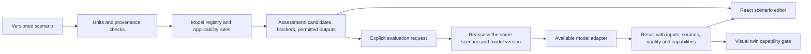

# Scenario Engine

Status: **backend, guided React Scenario Builder and schematic 3D implemented**. The engine decides which existing or
research model can answer a requested question, with which evidence and outputs.
It does not add physics, material constants, numerical presets or validation.
Scientific boundaries: [limitations](scientific-limitations.md).

## Implementation and scientific status

| Status | Current scope |
|---|---|
| **IMPLEMENTED** | Version 1 contracts, three-model registry, deterministic assessment, unit/provenance checks, per-output selection/refusal, revision fingerprints, existing dimensionless adapter, and guided React Scenario Builder with interactive schematic 3D |
| **BLOCKED** | 2016 and Urban evaluation; dimensional predictions; documented-experiment evaluation without reviewed inputs; unsupported physical outputs |
| **PENDING** | Reviewed parameter/derivation records, dimensional conversion adapters, sweeps, calibrated dynamic visual twin, original Urban equation pagination and complete reproduction audits |
| **VALIDATED** | No initial model has experimental validation by this project. Equations and software checks are verified separately; passing tests does not change this status. |

No new physical evaluator, material lookup, scientific constant, preset, database,
or raw-data derivation was added.

## Architecture



Keep the existing offline evidence pipeline, committed CSV/JSON, FastAPI and
React. The registry and decision rules belong in the same backend; assessment
and evaluation are pure, deterministic, in-memory operations. No database,
queue, external service or request-time source fetching is needed. Observations,
pixel metrics and published references retain their separate existing paths.

The registry owns versioned model metadata: scenario identifier, existing
evaluator identifier where present, exact equation variant, source file/page,
implementation status, applicability requirements, consumed inputs, required
provenance, permitted outputs and evidence status. Rules are explicit; model
selection does not use an LLM or a confidence score.

## Scenario contract

Implemented request fields, all without scientific defaults:

| Field | Contract |
|---|---|
| `schema_version`, `scenario_id`, `revision` | Version the contract and identify the user-edited scenario. Changes create a new revision. |
| `scenario_kind` | Explicit `hypothetical` or `documented_experiment`; the user cannot promote evidence status. |
| `requested_outputs` | Nonempty list of precise metrics, initially `dimensionless_branch`, `critical_flow_speed`, or `concurrent_spread_speed`; spatial/time evolution and physical diagnosis are separate capabilities. |
| `model_preference` | Explicit `auto` or one registry model ID; no substitution for a specifically requested model. |
| `environment` | Oxygen, pressure, airflow, gravity regime and gas composition; unknown values remain unknown. |
| `fuel` | Material identity/composition, geometry, thermal regime and heated-side convention, each with provenance. |
| `model_inputs` | Typed inputs keyed by model ID; each model gets its own parameter namespace. |
| `assumptions` | Explicit acknowledgments of source assumptions; distinguish user declarations from reviewed evidence. |
| `evidence_context` | Optional experiment, sample, sequence and processing-variant references; no inference from folder names. |

Every scalar quantity uses a value record with `state`, `value`, `unit`,
`origin`, `source_refs`, `scope`, and, for derived inputs, `derivation` and parent
references. `state` is `provided`, `missing` or `conflicting`; missing/conflicting
records have no usable numeric value. Absence is not zero. No imputed values.

`origin` distinguishes `user_assumption`, `documented` and `derived`.
Source references identify a claimed source record, file, version/hash when
available, printed page and equation/table. Unpaginated files use an exact
row/field locator and explicitly have no page. Unreviewed user citations remain
unreviewed; a URL or a filled page field does not automatically establish truth.
Derived values preserve the complete parent chain and the weakest input evidence.
Unknown uncertainty is omitted, never represented as zero uncertainty.

This increment has no reviewed experimental parameter registry or derivation
adapter. Documented/derived inputs retain their citations and parent chains but
cannot become usable essential inputs automatically. The executable path accepts
explicit hypothetical assumptions only. Sources in model metadata are reviewed
equation citations, not certified experimental input records.

`scope` records conditions under which a value applies: material, composition,
sample/setup, geometry, gas mixture, pressure, oxygen, evaluation temperature,
and other dependencies when documented. Source-derived properties become
unusable outside that scope. A changed slider cannot silently reuse a property
from an incompatible condition. No empirical validity interval is invented.

Reject unknown field names, ambiguous units, nonfinite values, booleans as
numbers, and conflicting parameter alternatives. Convert only explicitly
supported units and retain original values/units alongside normalized ones.
Mathematical/definitional checks are separate from empirical validity checks.

## Common scenario variables

| Variable | Representation and meaning |
|---|---|
| Oxygen | Mole/volume fraction with its basis, or another explicitly declared basis requiring a documented conversion; no implicit percent/fraction conversion. |
| Airflow | Speed [m/s], `opposed`/`concurrent`/`unknown` direction relative to spread, location (`inlet` or documented local position) and reference frame; do not equate inlet and local speeds. |
| Pressure | Absolute pressure [Pa]; gauge pressure requires documented conversion inputs. |
| Gas composition | Explicit mixture identity/fractions or unknown; oxygen alone does not define all gas properties. |
| Gravity | Declared regime (`microgravity`, `normal_gravity`, `other`, `unknown`) and magnitude [m/s²] only if available; no implicit numerical zero. |
| Material | User label or documented identity, composition and a versioned property set; material selection performs no automatic constant lookup. |
| Geometry | Shape, length, width, full thickness [m], documented areal mass [kg/m²] if available, and heated sides/conventions. Full and half thickness remain distinct. |
| Thermal regime | `thermally_thin`, `thermally_thick`, or `unknown`, with evidence or explicit hypothetical assumption. Thickness alone does not establish the regime. |

Documented image-derived lengths require the exact sequence/variant and a
manually validated calibration. Explicit hypothetical geometry is allowed as
an assumption and never establishes image calibration or material identity.

Common variables describe the scenario; they are not automatically inputs to
every equation. Responses list `used_inputs`, `context_only_inputs`,
`unsupported_controls` and dependency paths. Oxygen and pressure do not generate
temperatures, properties, `eta_g`, or radiation numbers without a separately
documented, implemented conversion. Geometry changes do not imply a flame-length
change in a model that has no such output.

## Initial model registry

### bhattacharjee2004_dimensionless

This is the requested scenario identifier for the implemented evaluator
`bhattacharjee2003_thin_radiative_v1`. The source publication is from 2003;
`2004` here identifies the user's registry name/NASA accession context, not a
new publication or equation. Preserve the existing API identifier and version.
Source: `20040053557.pdf`, Eq. (5), p.202; definitions Eq. (2), p.201.
Contract: [dimensionless model API](dimensionless-model.md).

- Applicability: opposed flow, steady reduced thin-fuel balance, microgravity
  assumptions explicitly declared. These declarations do not validate a real
  sample; unknown regime/configuration prevents a physical applicability claim.
- Numeric requirements: explicit finite nonnegative `eta_g` and
  `radiation_number`, both dimensionless, retaining the existing input contract.
- Available output: mathematical plus-root `eta_f`, discriminant and the current
  positive/zero/negative/non-real branch statuses; a non-real branch is an
  evaluated mathematical outcome, not missing evidence.
- Evidence: implemented and equation/software verified, experimentally
  unvalidated. No dimensional speed, physical extinction, material response,
  flame geometry or time evolution is permitted.
- Common dimensional controls do not affect its direct dimensionless inputs.
  Reject requests to calculate their physical effects without a documented
  dimensional conversion. Do not disguise dimensionless values as m/s.

### bhattacharjee2016_critical_flow

Source: `TM-20210011385.pdf`, Eq. (2.5), printed p.28; derivation pp.26–27.
Status: equation verified; future parametric evaluator, not implemented and not
reproduced against BASS-II with complete traceability. See
[research outcome](sources.md#bhattacharjee-2016-investigation).

- Applicability: the source's opposed-flow, microgravity, thermally thin
  radiative-extinction scaling assumptions; no transfer to concurrent spread.
- Required numeric inputs: `surface_emissivity` [dimensionless],
  `stefan_boltzmann_constant` [W/(m² K⁴)], `gas_density_at_Tv` [kg/m³],
  `gas_specific_heat` [J/(kg K)], `Tv`, `T_infinity` and `Tf` [K], with explicit
  temperature/property conventions. Even the physical constant must have an
  explicit value and provenance; no hidden default is proposed.
- Mathematical checks include nonzero positive denominator and positive
  absolute temperatures/property factors; positive critical-speed interpretation
  requires the source temperature ordering. These are not experimental ranges.
- Possible future output: conditional model estimate of `critical_flow_speed`
  [m/s], labelled parametric and unvalidated. It is not a flame spread rate or
  an observed extinction event. No safety or burning/extinction classification.
- Oxygen/pressure/material changes require compatible thermal/property inputs;
  geometry and imposed airflow are context unless a source-backed dependency
  consumes them. Fuel thickness does not occur in this critical-flow expression;
  that does not make it universally geometry-independent.
- Current decision: never executable; report missing inputs and implementation
  blockers independently. Failed BASS-II reproduction also blocks a reproduced
  result claim, even if future hypothetical inputs are complete.

### urban2019_concurrent_spread

Scope: the approximate thermal Eq. (2), not the unresolved full Eq. (1) and not
the proportionality-only Eq. (6). The equation is verified in publisher HTML;
printed equation pagination is still unresolved. Status: not implemented and
not dimensionally reproducible with full traceability using available sources.
See [audit](urban-reproducibility-audit.md).

- Applicability: concurrent flow, thin-fuel approximation and the source's
  explicitly acknowledged thermal/kinetic/radiation assumptions. Other flow or
  thermal regimes are rejected. Gravity/context applicability must be declared;
  a coefficient from a different environment cannot be reused silently.
- Required numeric inputs: `pyrolysis_length` [m],
  `solid_areal_mass` [kg/m²] or a consistent documented pair `solid_density`
  [kg/m³] and `solid_full_thickness` [m], `solid_specific_heat` [J/(kg K)],
  `Tp`, `To`, `Tf` [K], and `convective_heat_transfer_coefficient` [W/(m² K)].
  Conflicting areal-mass alternatives or heating conventions are rejected.
- The coefficient is supplied explicitly. A future correlation adapter would
  need its own verified equation/page, correlation constant, gas conductivity,
  density, viscosity, Prandtl number and flow/gravity conventions; inlet airflow
  is not a substitute for that adapter or for `h`.
- Mathematical checks include positive thermal capacity, positive heating length,
  and the source temperature ordering for a positive spread estimate. No
  empirical bounds are added.
- Possible future output: conditional concurrent spread estimate [m/s], with
  observed/assumed pyrolysis length marked as input. It cannot independently
  predict that length, flame shape or transient spread.
- Current blockers: missing complete case-specific inputs, unimplemented
  evaluator, unresolved printed equation citation, and absent reproduction.
  Source verification/page is a hard gate before exposing a dimensional model
  claim in UI/API. Complete hypothetical inputs would not establish reproduction.

## Assessment, selection and rejection

Assess every candidate against each requested output, aggregating blockers:

1. Validate syntax, units, origins and source scope; preserve missing/conflicting
   values. Bad contracts are `invalid_request`, not scientific rejection.
2. Check flow, thermal regime, source assumptions and requested output. A known
   mismatch gives `incompatible`; unknown required context gives
   `insufficient_evidence`, with the exact unresolved field.
3. Check required numeric inputs, provenance and dependencies. Hypothetical
   values can support only hypothetical/mathematical results. A documented
   experiment with assumed essential inputs cannot receive a documented-result
   claim; creating a hypothetical alternative requires an explicit user action.
4. Check equation/citation verification, implementation and permitted evidence
   claims. Track `compatibility`, `readiness`, `reproduction` and `validation`
   separately. A model can be compatible yet not implemented or not evidenced.
5. Select only an implemented, eligible model that can produce the exact
   requested metric. Auto-selection requires one eligible candidate per metric.
   Multiple eligible variants require an explicit choice, not a silent ranking.
6. Return every candidate, reasons, missing fields and permitted alternatives.
   Never fall back from a requested dimensional speed to a dimensionless number,
   from concurrent to opposed flow, or from prediction to a published reference.

Assessment returns a deterministic fingerprint of the normalized scenario and
registry/model versions, plus selection and blockers. A subsequent evaluation
reassesses the submitted scenario; an assessment token is not trusted authority.
Both response and UI retain the scenario revision/fingerprint so stale responses
cannot replace results for newer slider values. Each requested metric receives
its own disposition; no overall success hides a blocked metric.

The implemented response uses the existing `{data, source, warnings, quality}` envelope.
`data` includes candidate assessments, selected models, `permitted_outputs`,
`blocked_outputs`, `missing_parameters`, `evidence`, input dependencies and
`visual_capabilities`. A blocked assessment carries structured reasons, not
fabricated result values. Assessment itself has no numeric model quality;
`quality="unavailable"` until evaluation produces a result.

## Quality and evidence

These are independent dimensions, not one confidence ladder:

| Dimension | States and meaning |
|---|---|
| Result quality | `unavailable`; `modelled_unvalidated` for all initially permitted computations; `published_reference` only for existing reference records, never an engine prediction |
| Result kind | Mathematical dimensionless branch; hypothetical parametric estimate; future documented parametric estimate; external published observation |
| Equation evidence | Verified file/page; verified HTML with page unresolved; unverified. Keep variant and limitations attached. |
| Software evidence | Implemented/tested or not implemented; passing synthetic tests verifies software only. |
| Input evidence | Assumed, documented/reviewed, derived with complete chain, missing or conflicting; determined by backend checks and reviewed records |
| Reproduction evidence | Not attempted, incomplete/not reproduced, or future independently reproduced for a named case with documented inputs/calculation/error |
| Experimental validation | Unvalidated for all three initial models; any future validation must cite a reviewed validation report and explicit applicable scope |

Documented parameters do not turn a parametric estimate into an observation.
Independent reproduction of one published number does not establish experimental
validation or extend validity to changed materials, oxygen, pressure or geometry.
No initial result is labelled scientifically/experimentally validated, safe,
dangerous, ignited or extinguished. Evidence metadata is server-owned.

## Insufficient-evidence messages

Reason records contain `code`, `model_id`, `requested_output`, `field_path`,
`message`, `needed_evidence` and a concrete next action. Product copy is English.

| Code | Message meaning |
|---|---|
| `missing_parameter` | “Insufficient evidence: {model} requires {parameter} in {unit}. No value has been assumed.” |
| `missing_context` | “Insufficient evidence: the flow configuration or thermal regime has not been established.” |
| `incompatible_scenario` | “This model describes opposed flow. The scenario requests concurrent spread.” |
| `missing_dependency` | “Changing oxygen does not determine the model temperatures or gas properties. Provide inputs supported for the new conditions.” |
| `source_scope_mismatch` | “This property is documented for different conditions and cannot be reused for the current scenario.” |
| `conflicting_sources` | “The supplied sources disagree on {parameter}. Resolve the conflict before using this value.” |
| `source_not_reviewed` | “The citation is retained, but this parameter has no reviewed backend evidence record.” |
| `derivation_not_reviewed` | “The supplied derivation is preserved, but no reviewed conversion adapter is implemented.” |
| `incomplete_derivation` / `cyclic_derivation` | “The parent provenance is incomplete or circular.” |
| `missing_parameter_alternative` | “Provide areal mass or the complete density/full-thickness pair.” |
| `conflicting_parameter_alternatives` | “Multiple areal-mass representations were supplied; choose one explicitly.” |
| `documented_evaluation_unavailable` | “No reviewed experimental input set is implemented.” |
| `source_page_unverified` | “The equation is verified in HTML, but its printed source page remains unverified. Dimensional evaluation is unavailable.” |
| `model_not_implemented` | “The equation has been investigated, but this evaluator is not available.” |
| `output_not_supported` | “This evaluator returns a dimensionless mathematical branch. It cannot return a speed in mm/s.” |
| `reproduction_not_established` | “No traceable reproduction has been established. Any future estimate remains unvalidated.” |
| `visual_capability_unavailable` | “This steady model provides no flame position, shape or time evolution for an image overlay.” |

Unavailable implementation and incompatible output are reported with their own
codes even when scientific inputs are complete; missing evidence is not a generic
catch-all. The response identifies all blockers instead of stopping at the first.

## Frontend and future dynamic visual twin connection

React edits a draft scenario and displays assessment before evaluation. Users
can vary oxygen, airflow, pressure, material and geometry as explicit values or
future explicit hypothetical sweep ranges; no scenario presets, slider ranges or
material constants are invented. Numerical inputs can remain blank/unknown.
Expose a control as a physical sensitivity only when the selected model has a
complete consumed-input dependency. Otherwise show the control as context with
an explanation, or disable that sensitivity calculation.

Display each candidate's applicability, missing inputs, permitted outputs and
evidence separately. Results show units, assumptions and source locators next to
the value. Published references remain in the separate Scientific context view;
comparison requires compatible conditions and never fits inputs to match them.
User-edited conditions invalidate dependent source properties and prior results.
Future sweeps must assess every case; a failed case is labelled unavailable, never filled
with zero or interpolated into a supposedly physical result. Existing evaluation
batch behavior remains unchanged; a future sweep layer handles case outcomes.

The guided interface shows a generic 3D sample, a fixed illustrative flame symbol
and separately labelled mathematical results. Capability metadata explicitly denies
physical image overlays, predicted flame shape, animated propagation and
temperature/heat-release/risk displays. Display geometry does not change these gates.
A steady 0D result supplies neither a position nor an evolution equation.

Future measured overlays require documented sample/sequence mapping, one
processing variant, manually validated calibration and documented temporal
alignment. A future physical animation additionally requires an applicable
spatial/transient model and source-backed initialization. Evidence playback
remains observation playback; no existing model is stretched into a calibrated
visual prediction or used to derive rates through temporal gaps.

## First implementable increment

**IMPLEMENTED:** the backend assessment layer and adapter to the existing
dimensionless evaluator only, in scenario_contracts.py, scenario_registry.py and
scenario_engine.py. The following items describe the delivered scope.

- Add versioned scenario/assessment contracts, a registry with the three requested
  IDs, and pure deterministic compatibility, requirements and output rules.
- Implemented endpoints: `GET /api/twin/scenario-models` for registry/status;
  `POST /api/twin/scenarios/assess` for readiness and evidence; and
  `POST /api/twin/scenarios/evaluate` for an explicitly eligible dimensionless
  scenario. Preserve existing `/api/twin/models` and `/api/twin/evaluate` contracts.
- Register 2016 and Urban as research-only candidates. Return complete blocker
  reports for them; neither gains an evaluator, dimensional defaults or presets.
- Adapt the 2004 scenario ID to the existing 2003 evaluator ID, preserving its
  input validation, mathematical branch statuses, versions and quality label.
- Return scenario revision, provenance, dependencies and visual capabilities;
  no frontend or visual animation is required for this first backend increment.
- Focused tests must verify correct routing, opposed/concurrent rejection,
  missing inputs/context, conflicting or out-of-scope evidence, unsupported
  outputs, no fallback/defaults, every blocker on research candidates, preserved
  branch outcomes, and version/revision handling. Software tests must not assert
  reproduction of published numbers or physical validation.
- Update API/data-contract docs and run the repository's Python and frontend
  checks. Acceptance: dimensionless hypothetical scenarios yield only mathematical
  outputs; the two research models remain unevaluable with explicit reasons;
  edits to unsupported common controls produce no claimed physical sensitivity.

The backend increment is now consumed by the implemented frontend below. Sweeps
and a calibrated dynamic visual twin remain **PENDING**. The two dimensional
research evaluators remain **BLOCKED**, and experimental validation is absent.

## Implemented Scenario Builder

The **Explore a mathematical model** mode at `#Twin` uses a guided model-first flow and a central
interactive Three.js scene. Only the selected model's inputs are exposed; the
implemented dimensionless flow asks for `eta_g` and `radiation_number` only.
Numeric fields start blank. Selecting a clearly labelled setup explicitly records
its source conditions/assumptions, without converting context into model inputs.
One action assesses the current revision and evaluates only if the engine permits it.

Primary results show the ratio, mathematical state, explanation, source and quality.
Advanced scenario conditions and Scientific details retain exact requirements,
blockers, discriminant, warnings, versions and provenance. Every scientific edit
invalidates previous results; aborted/late responses cannot restore them. The
research evaluators remain blocked. Existing API contracts and physics are unchanged.

The 3D is **schematic**, not a capability upgrade of the physical model. It receives
only declared flow direction, gravity label and shape category. It never consumes
numeric outputs, temperature or speed. Model capability flags for physical flame
shape, overlays and time evolution remain false. The full classification of
calculated mathematics, scenario-derived elements and presentation is owned by
[Guided Digital Twin and schematic 3D](digital-twin-3d.md).

## Implemented API contract

All three new endpoints use the existing four-field envelope. No endpoint adds
defaults for scientific inputs. Optional scientific fields become absent/null
records only; a missing namespace produces the complete model requirement report.

| Endpoint | Request / response |
|---|---|
| GET /api/twin/scenario-models | Version 1 registry; model/evaluator versions, exact source locators, numeric requirements/alternatives, assumptions and evidence |
| POST /api/twin/scenarios/assess | ScenarioRequest → ScenarioAssessment; all candidates, compatibility/readiness, reasons, exact-output dispositions, normalized values, original provenance, fingerprint and visual capabilities |
| POST /api/twin/scenarios/evaluate | ScenarioEvaluationRequest with scenario and assessment_fingerprint → reassessment and the existing dimensionless result, with input provenance and source metadata |

Registry and assessment use quality unavailable because no numerical result is
returned. Assessment returns HTTP 200 even when candidates are blocked.
Evaluation returns modelled_unvalidated only for an eligible hypothetical
dimensionless result. Blocked/invalid evaluation returns 422, stale scenario or
registry fingerprints return 409, and unknown preferred model IDs return 404.
Errors retain the envelope; invalid NaN/Infinity values are not echoed.

Version 1 mandatory top-level scenario fields are schema_version, scenario_id,
revision, scenario_kind, requested_outputs, model_preference, environment, fuel,
model_inputs, assumptions, and evidence_context. Unknown fields and duplicate
outputs are rejected. model_preference is auto or one registry ID; the schema
permits draft missing values, and assessment refuses unusable essential fields.
An evaluation must resubmit the scenario, not just an assessment or token.
Multiple requested outputs are assessed individually, but evaluation returns no
partial results if any requested output is blocked.

Quantity/declaration records require state, value, origin, source_refs and scope;
quantities also require unit. State is provided, missing or conflicting; only
provided records may contain usable values. SourceReference requires source_id,
file, page (positive integer or null for unpaginated sources) and locator;
version/hash are optional. Derived inputs additionally require formula,
source_refs and parent field paths. They are preserved, checked for absent
parents/cycles, and blocked as essential inputs until a reviewed adapter exists.
Documentation does not authorize execution of a submitted formula.

Numeric units use explicit API strings: dimensionless, fraction, %, m, cm, mm,
m/s, cm/s, mm/s, Pa, kPa, K, m/s2, kg/m3, kg/m2, mg/cm2, J/(kg*K), W/(m2*K),
W/(m2*K4). Only compatible identities/conversions are performed; temperatures
require kelvin and pressure requires absolute pressure in the supplied context.
Oxygen and gas fractions require basis mole, volume or mass; mass fractions are
never transformed into mole fractions. Scope conditions use exact field paths
and normalized canonical values. Original input units/values remain in provenance.

Declarations use value opposed/concurrent/unknown for airflow direction;
microgravity/normal_gravity/other/unknown for gravity;
thermally_thin/thermally_thick/unknown for thermal regime; and
acknowledged/rejected/unknown for each assumption. Airflow speed, location and
reference frame are separate records. They do not convert the direct eta_g input.

The following zero-radiation case is a synthetic mathematical contract example,
not a scientific preset or a SAFFIRE experiment:

```json
{
  "schema_version": "1",
  "scenario_id": "synthetic-math-case",
  "revision": 1,
  "scenario_kind": "hypothetical",
  "requested_outputs": ["dimensionless_branch"],
  "model_preference": "auto",
  "environment": {
    "airflow": {
      "direction": {
        "state": "provided", "value": "opposed", "origin": "user_assumption",
        "source_refs": [], "scope": {}
      }
    },
    "gravity_regime": {
      "state": "provided", "value": "microgravity", "origin": "user_assumption",
      "source_refs": [], "scope": {}
    }
  },
  "fuel": {
    "geometry": {},
    "thermal_regime": {
      "state": "provided", "value": "thermally_thin", "origin": "user_assumption",
      "source_refs": [], "scope": {}
    }
  },
  "model_inputs": {
    "bhattacharjee2004_dimensionless": {
      "eta_g": {
        "state": "provided", "value": 0.0, "unit": "dimensionless",
        "origin": "user_assumption", "source_refs": [], "scope": {}
      },
      "radiation_number": {
        "state": "provided", "value": 0.0, "unit": "dimensionless",
        "origin": "user_assumption", "source_refs": [], "scope": {}
      }
    }
  },
  "assumptions": {
    "steady_reduced_balance": {
      "state": "provided", "value": "acknowledged", "origin": "user_assumption",
      "source_refs": [], "scope": {}
    }
  },
  "evidence_context": {}
}
```

Post this object to assess, then submit an object with scenario equal to the
same object and assessment_fingerprint equal to the returned fingerprint.
The result echoes original provenance, scenario/revision, registry/model/evaluator
versions, units, source, evidence and mathematical branch status. Non-real roots
remain evaluated mathematical outcomes, not extinction diagnoses or missing evidence.

Every reason has blocks_evaluation. Research-model reproduction gaps are
informational reasons for hypothetical estimates; model_not_implemented remains
a hard blocker in this increment. Missing numeric requirements, incompatible
context, unresolved Urban pagination and unreviewed essential provenance are
hard blockers. Context-only unreviewed records are retained without promoting
them to used inputs or changing the mathematical result.

Visual capability flags are permissions for a future consumer, not an implemented
UI. A hypothetical geometry schematic requires explicit assumed shape/length/width
without provenance blockers. Physical overlay, flame shape, time evolution,
temperature, heat release and fire risk are always false. unsupported_controls
identifies common controls without implemented physical dependency adapters.
missing_dependency and visual_capability_unavailable messages above describe
future UI cases; current unsupported requests use output_not_supported.

## Separate SAFFIRE playback capability

The Twin also offers [published-reference playback](saffire-playback.md), served
by separate GET endpoints. This is **IMPLEMENTED** derived steady kinematics
from experimental references, not a fourth predictive model or an Urban evaluator.
It does not alter registry availability, scientific validation or visual capability
gates for scenario evaluation. Its trajectory contract is separate from
ScenarioRequest; arbitrary oxygen/airflow/material inputs cannot modify published
case values. Mathematical results retain `modelled_unvalidated`.
